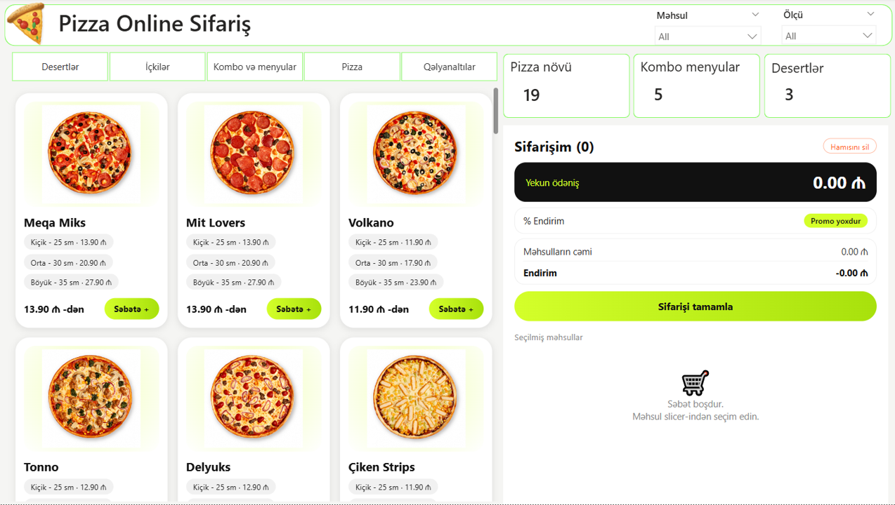

# 🍕 Pizza Online Ordering UI | Power BI

A web-style pizza ordering interface designed and developed in **Microsoft Power BI** using the **HTML Content** custom visual.

This project demonstrates how Power BI can go beyond traditional analytical dashboards and be used to create visually engaging, application-like user interfaces.

## 📸 Project Preview

## 🎯 Project Overview

The goal of this project was to design a pizza ordering experience similar to an online food delivery platform, using Power BI's visualization capabilities.

Instead of focusing on traditional data analysis, the project focuses on UI design, layout development, and the creative use of HTML and CSS within Power BI.

## ✨ Key Features

- **Product Catalogue:** Visual product cards displaying pizza images, names, sizes, and prices.
- **Category Navigation:** Separate categories for pizzas, desserts, drinks, combo meals, and side dishes.
- **Product Filters:** Filter areas for products and sizes.
- **Shopping Cart Interface:** An order summary panel displaying selected products, total price, and discount information.
- **Modern UI Design:** Clean layout, rounded cards, consistent typography, and bright accent colors.

## 🛠️ Tools & Technologies

- Microsoft Power BI Desktop
- HTML
- CSS
- HTML Content Custom Visual

## 💡 Project Highlights

- Explored the integration of HTML and CSS into Power BI.
- Designed a web-inspired interface within a business intelligence environment.
- Experimented with custom visual layouts and interactive-looking components.
- Explored alternative use cases of Power BI beyond conventional reporting.

## 📌 Project Scope

This project is a **UI/visualization concept**, not a fully functional e-commerce application.

It focuses on the visual representation of an online pizza ordering platform rather than real payment processing, order management, or delivery operations.

## 👩‍💻 Author

**Fatima Sadixova**

Data Analytics | Power BI | Business Intelligence

---

*Created as a personal portfolio project.*
